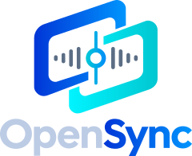

# OpenSync

<p align="center">
  
</p>

<p align="center"><strong>Open-source audio and video synchronization for professional editing workflows.</strong></p>

<p align="center">Native Go engine · Windows desktop workstation · Evidence-based synchronization · GPL-3.0-or-later</p>

OpenSync is an independent, community-driven application for synchronizing recordings from multiple cameras, microphones, and audio recorders.

It is designed for real-world production scenarios: recordings that start and stop at different times, partially overlap, exhibit clock drift, contain repeated sounds, or have significantly different acoustic characteristics.

The project combines a native synchronization engine with a desktop timeline for inspecting results, reviewing evidence, and preparing synchronized media for editing applications.

**Our goal is to build a reliable, high-performance, freely available alternative to proprietary synchronization tools, without compromising transparency or source-media integrity.**

> **Project status — Public alpha development**
>
> OpenSync currently includes a native Go synchronization engine, a Windows desktop workstation, an interactive waveform timeline, buffered multicamera monitoring, review revisions, configurable sync/export policies, and Premiere-compatible XML export. The public alpha is available as a portable Windows x64 package.
>
> This is an early alpha, not a production-certified release. The engine acceptance benchmark remains advisory and has known gaps; Premiere XML has structural checks but is not certified across all Premiere versions, media types, or production workflows. See [known limits and benchmark results](docs/ENGINE-ACCEPTANCE.md) before relying on a result without review.
>
> Download [OpenSync v0.1.0-alpha.2](https://github.com/Rayan-Refoua/OpenSync/releases/tag/v0.1.0-alpha.2) or browse [all releases](https://github.com/Rayan-Refoua/OpenSync/releases).

---

## Why OpenSync?

Commercial synchronization software has demonstrated how valuable automatic multicamera alignment can be. OpenSync aims to provide these capabilities as an open, inspectable, independently developed engineering project.

Our priorities are:

- **Accurate acoustic alignment:** Find recording relationships despite differences in microphones, recording equipment, gain, noise, and room acoustics.
- **Difficult-recording recovery:** Investigate short overlaps, weak signals, distant microphones, repeated content, and disconnected recording groups.
- **Evidence instead of guesswork:** Preserve candidate offsets, alternative hypotheses, acoustic observations, confidence information, and unresolved results.
- **Clock-drift handling:** Evaluate constant, affine, and piecewise timing relationships where justified by the available measurements.
- **Non-destructive processing:** Keep original recordings unchanged and store synchronization decisions separately.
- **Professional timeline inspection:** Navigate synchronized recordings, inspect waveforms, audition audio, and review multiple camera feeds.
- **Editor interoperability:** Save OpenSync projects and export Premiere-compatible XML timelines.
- **Offline-first architecture:** Run synchronization locally without a cloud service or subscription.
- **Reproducible engineering:** Use deterministic tests, independent verification, performance measurements, and documented limitations.

OpenSync does not assume that every recording can be synchronized. A result that remains unresolved is preferable to a confidently incorrect placement.

## Current capabilities

| Component                                                   | Implementation status                                |
| ----------------------------------------------------------- | ---------------------------------------------------- |
| Native Go synchronization engine                            | Implemented; reliability development ongoing         |
| Acoustic fingerprint discovery                              | Implemented                                          |
| Candidate offset verification and competing-offset controls | Implemented                                          |
| User-configurable acoustic verification controls            | Implemented in GUI and CLI                           |
| Multiband envelope and distributed recovery                 | Implemented                                          |
| Multi-observation timing and drift analysis                 | Implemented; coverage varies with available evidence |
| Global temporal evidence graph                              | Implemented                                          |
| Filename-based recording continuity analysis                | Available; not treated as acoustic proof             |
| File-time placement in chronological mode                    | Optional, bounded, and explicitly provisional         |
| Audio refinement of eligible file-time estimates             | Implemented; retains chronological uncertainty        |
| Native `.opensync` project format                           | Implemented                                          |
| Windows desktop timeline                                    | Working alpha                                        |
| Waveform rendering and navigation                           | Implemented                                          |
| Synchronized audio audition                                 | Implemented                                          |
| Multicamera preview monitor                                 | Implemented; bounded performance testing             |
| Evidence inspection and review revisions                    | Implemented                                          |
| Premiere-compatible FCP7 XML export                         | Implemented; real-editor validation ongoing          |
| Audio drift-correction WAVs for eligible recorder tracks    | Implemented; configurable lead/lag tolerances        |
| Timeline filename search and project drag-and-drop          | Implemented                                          |
| Additional NLE interchange formats                          | Planned                                              |
| General-purpose manual timeline editing                     | Not yet implemented                                  |
| Packaged public releases                                    | Windows x64 portable alpha available                 |

The available functionality is more extensive than this summary. Technical details and limitations are maintained in the [documentation directory](docs/).

## Architecture

OpenSync separates synchronization evidence, timing-model estimation, timeline presentation, and editor export.

The core engine is implemented in **Go**, with FFmpeg and FFprobe used for media decoding and metadata inspection.

The Windows desktop uses **Wails v2**, vanilla JavaScript, Canvas 2D, Web Audio, and Microsoft Edge WebView2.

The GUI and CLI share the native Go engine. The desktop does not execute the CLI as a subprocess, and the production synchronization runtime does not require Python.

### Synchronization pipeline

The native synchronization pipeline combines:

1. **Media discovery and preparation** — inspect sources, validate metadata, and prepare bounded audio access.
2. **Acoustic feature extraction** — generate compact features for efficient candidate discovery.
3. **Candidate discovery** — identify possible recording relationships and alternative offsets.
4. **Acoustic verification** — measure candidate offsets using waveform and spectral evidence with competing-offset controls.
5. **Recovery search** — investigate unresolved recordings using additional signal representations and search strategies.
6. **Independent-region validation** — test selected hypotheses against acoustic regions not used by initial measurements.
7. **Timing-model analysis** — evaluate supported offset and clock-rate relationships.
8. **Global consistency solving** — compose temporal constraints, identify contradictions, and construct supported connected components.
9. **Project finalization** — preserve evidence, mark unresolved placements, and produce an editable project representation.
10. **Timeline export** — construct an editor-compatible timeline without modifying the source recordings.

These are **logical responsibilities**, not a claim that every recording always requires exactly ten processing passes. The desktop currently reports eleven progress stages corresponding to its orchestration.

Some recovery operations are computationally expensive and remain targets for adaptive scheduling and optimization.

### Evidence model

OpenSync does not treat a correlation maximum as sufficient proof of synchronization.

Depending on the analysis path, hypotheses may be evaluated using:

- Sparse acoustic fingerprints.
- Waveform correlation.
- Spectral flux and multiband features.
- Competing incorrect-offset controls.
- Measurements from multiple recording regions.
- Held-out acoustic observations.
- Timing-model residuals.
- Global graph consistency.
- Alternative event hypotheses.

The engine distinguishes acoustically supported relationships from independently certified results. Current graph output does not claim independent physical-capture-time certification.

Filename sequences and recording metadata can assist candidate prioritization or chronological presentation, but they are not sufficient to establish an acoustic timing edge.

### Timing and drift

A single constant offset may be insufficient when independent recording devices have slightly different clocks.

OpenSync includes timing-model infrastructure for estimating how relative timing changes across a recording. Supported representations include affine relationships and monotonic piecewise mappings.

Model selection and precision depend on the available evidence. The application must preserve uncertainty where a reliable timing model cannot be established.

High numerical precision must not be confused with experimentally demonstrated accuracy.

### Resource management

The engine is designed around bounded workloads and controlled concurrency.

Relevant mechanisms include:

- Streaming and chunked audio processing.
- RAM-first analysis and optional persistent caches.
- Reusable acoustic features.
- Bounded worker pools.
- Controlled decoder concurrency.
- Direct native sample access for compatible PCM sources.
- FFmpeg fallback for formats requiring decoding or conversion.
- Source-storage-aware I/O scheduling.
- Cancellation of obsolete visualization work.

Persistent analysis caching is disabled by default in the normal synchronization workflow. Use `--cache` and `--resume` when explicitly retaining and reusing analysis data.

The application does not copy or modify original recordings as part of ordinary synchronization.

For implementation details, see [Native Go migration](docs/NATIVE-GO-MIGRATION.md) and [Desktop architecture](docs/DESKTOP.md).

## Windows desktop workstation

The desktop provides a graphical environment for synchronization and review.

Current functionality includes:

- Add individual recordings or recursively import folders.
- Synchronize recordings directly through the native Go engine.
- Open saved `.opensync` projects.
- Open a project by dropping its `.opensync` file or project folder onto the window.
- Navigate a zoomable, scrollable timeline with waveforms.
- Find recordings by filename and jump to their timeline positions.
- Inspect media metadata and synchronization evidence.
- Audition synchronized audio.
- Monitor multiple camera feeds.
- View provisional progress while synchronization is running.
- Inspect unresolved recordings and conflicting placements.
- Reject or restore selected synchronization relationships.
- Re-evaluate saved evidence without repeating full acoustic analysis.
- Maintain reversible project solution revisions.
- Export the currently opened result to a Premiere-compatible XML timeline.
- Configure recovery depth, input-reading policy, reader concurrency, worker and memory budgets, track grouping, unmatched-media handling, provisional exports, and audio lead/lag tolerances.

### Multicamera monitoring

The workstation supports configurable multicamera preview layouts, with up to 16 selectable feeds.

Video previews use reduced-resolution H.264 segments generated through bounded media workers, while the browser handles playback and display. Source video is not re-encoded or modified in place.

The playback system includes buffering, source-time mapping, coordinated refill behavior, and bounded clock correction.

Four-camera playback has undergone controlled testing. Sixteen-camera performance and compatibility across all codecs, GPUs, and storage devices are not yet certified.

### Timeline and visualization

The application uses viewport-aware rendering rather than constructing all waveform detail at maximum resolution.

A reusable peak hierarchy supports different zoom levels, while obsolete viewport requests can be cancelled to reduce unnecessary work.

Project timing retains the precision of the engine's stored model; display-frame stepping does not quantize the underlying synchronization solution.

The desktop is currently a **synchronization and review workstation**, not a complete nonlinear video editor.

Audio-only recorder drift correction can create a 24-bit WAV alongside an eligible original and point the Premiere XML at the corrected audio. The source remains unchanged; the allowed audio lead and lag are configurable. Video is never retimed by this correction path. Keep the generated WAV with the source media when moving or relinking the exported project. See [timeline preparation and export guidance](docs/SYNC-TIMELINE.md).

See [Desktop documentation](docs/DESKTOP.md) for controls, playback architecture, source-media handling, and tested limitations.

## Getting started

### Windows — Prebuilt alpha

Check the [Releases page](https://github.com/Rayan-Refoua/OpenSync/releases) for an available Windows build.

For a packaged release:

1. Download the Windows x64 archive.
2. Extract the entire archive into a folder.
3. Launch `opensync.exe` for the desktop workstation.
4. Add recordings and run synchronization.
5. Inspect uncertain or unresolved results before exporting.

The current published build is [v0.1.0-alpha.2](https://github.com/Rayan-Refoua/OpenSync/releases/tag/v0.1.0-alpha.2). It is a portable alpha, not an installer; Windows file associations and an installer are not included.

The package is designed to keep `ffmpeg.exe` and `ffprobe.exe` in `runtime/bin` beside the application executables.

Microsoft Edge WebView2 Runtime is required for the desktop application. Windows may show a SmartScreen warning for unsigned or newly distributed binaries.

Do not move the executables out of their package directory unless the required media tools remain accessible.

### Command line

The headless CLI is available as `opensync-cli.exe` in the Windows desktop package, or can be built independently.

```bash
# Synchronize recordings from folders.
opensync-cli sync --folders CameraFolder AudioFolder --output MyProject

# Synchronize selected recordings.
opensync-cli sync --files camera.mp4 recorder.wav --output MyProject

# Use a UTF-8 text or JSON file list.
opensync-cli sync --file-list media-files.json --output MyProject

# Re-export a saved project.
opensync-cli export MyProject/OpenSync.opensync --output Export

# Inspect available options.
opensync-cli sync --help
opensync-cli export --help
```

Folder scanning is recursive. The engine reports unusable or excluded inputs rather than silently treating them as synchronized recordings.
Analysis caching is disabled by default. Use `--cache` when you explicitly want to retain reusable analysis data; `--resume` resumes compatible cached work.

### Chronological and review workflows

The CLI supports acoustic clip placement, chronology-aware presentation, and configurable verification thresholds.

```bash
opensync-cli sync \
    --folders CameraFolder AudioFolder \
    --mode chronological \
    --output ChronologicalProject
```

Chronological mode can estimate bounded gaps from recording-order evidence. These estimates remain explicitly provisional and do not establish acoustic synchronization.

When **File time Based placement** is enabled, OpenSync can use calibrated file dates and recording succession to estimate otherwise unresolved positions. On eligible short-overlap cases, agreeing acoustic windows can refine the estimate's position. The timeline identifies these as **AUDIO REFINED** while retaining their chronological, provisional status; this refinement is not an independently certified synchronization result. The GUI's **Add chronological placements** action and CLI's `revise --add-chronological` can apply the same process to a saved project revision. See [timeline preparation and export guidance](docs/SYNC-TIMELINE.md) for the evidence rules and examples.

The GUI and CLI also expose user-configurable waveform, spectral-flux, wrong-offset-control, ambiguity, and event-grouping settings. These affect acoustic verification decisions; the export residual limit is a separate presentation constraint. A broader recovery search may discover more hypotheses, but it does not automatically weaken the verification criteria. Use `opensync-cli sync --help` for defaults and valid ranges.

A saved project can also be re-evaluated:

```bash
opensync-cli revise MyProject/OpenSync.opensync --mode chronological
opensync-cli revise MyProject/OpenSync.opensync --mode chronological --add-chronological
```

Review actions retain explicit recording and relationship rejections in project revisions.

For the complete behavior and available options, consult `--help` and [Desktop review documentation](docs/DESKTOP.md).

## Building from source

### Requirements

- Go **1.23 or newer**.
- FFmpeg and FFprobe.
- Git.
- Windows and Microsoft Edge WebView2 Runtime for the desktop build.
- Node.js for frontend tests.
- PowerShell for the packaged Windows build.

The desktop is maintained as a separate Go module to keep Wails dependencies isolated from the native engine.

### Clone the repository

```bash
git clone https://github.com/Rayan-Refoua/OpenSync.git
cd OpenSync
```

### Build the native CLI

```bash
go build -o opensync ./cmd/opensync
```

On Windows, choose an `.exe` output filename.

### Build the Windows desktop distribution

Use the repeatable build-and-open script from PowerShell:

```powershell
python tools/build_open_windows.py
```

This closes existing OpenSync app instances, replaces the local package under `release/`, builds the desktop and CLI, and launches the newly built GUI. It removes only that named package directory and any stale adjacent ZIP archive; it does not remove or publish GitHub releases. The packaging script is also available directly when a separate empty destination is preferred:

```powershell
.\tools\build_desktop_windows.ps1 -Output C:\OpenSync-Build
```

This script builds both the desktop and CLI, bundles FFmpeg/FFprobe, generates Windows resources, records dependency licenses, and produces package integrity metadata.

### Build the desktop module directly

From the repository's `desktop` directory:

```powershell
go run ./tools/winresources
go build -tags desktop,production -ldflags "-H windowsgui" -o opensync.exe .
```

Direct builds require the relevant runtime dependencies to be available. The packaged build script is preferred for distribution.

## Testing and validation

OpenSync prioritizes measurable synchronization accuracy over merely successful program execution.

Run the core Go tests and static analysis:

```bash
go test ./...
go vet ./...
```

Run frontend tests:

```bash
cd desktop/frontend
node --test
```

Run desktop Go checks separately from the nested module:

```bash
cd desktop
go test ./...
go vet ./...
```

For FFmpeg integration tests, enable the integration environment setting:

```powershell
$env:OPENSYNC_INTEGRATION = "1"
go test ./...
```

### Engine acceptance benchmarks

OpenSync includes a deterministic synthetic acceptance benchmark:

```bash
go run ./cmd/opensync benchmark --output acceptance --profile quick
```

The benchmark produces machine-readable and human-readable reports.

It exercises acoustic matching, ambiguity handling, timing behavior, and reproducibility under controlled conditions.

The full profile includes longer-duration timing fixtures and requires additional resources.

**Current status:** The acceptance benchmark is advisory and known capability gaps remain. The recorded baseline is not a passing production-accuracy claim. Passing unit tests does not establish synchronization accuracy, and synthetic benchmark success does not guarantee correct matching on arbitrary real-world recordings.

Read [Engine acceptance](docs/ENGINE-ACCEPTANCE.md) for the benchmark contract, error thresholds, known limitations, and interpretation of readiness results.

### Real-world validation

Real recordings are necessary to expose failure modes that synthetic tests may not represent:

- Distant microphone recordings.
- Public-address-system delay and reverberation.
- Repeated musical or acoustic events.
- Partial and interrupted recordings.
- Camera/recorder clock drift.
- Very short recordings.
- Weak or absent acoustic overlap.
- Long reference recordings.
- Segmented camera recordings.
- Variable-frame-rate and complex media containers.

The project records measured results and unresolved failures rather than treating every recovered candidate as correct. Review provisional and supported placements in the project before using an exported timeline; do not read an exported clip's presence as proof that its synchronization was independently validated.

### Independent comparisons

OpenSync intends to compare against:

- [Align](https://github.com/FedyaLight/align)
- Red Giant PluralEyes 4
- Syncaila

Comparisons should use identical source recordings, documented settings, reproducible procedures, and independently checked ground truth wherever possible.

Relevant metrics include offset error, drift residual, match recall, false-positive rate, unresolved recordings, runtime, memory consumption, and successful NLE imports.

**No general claim of superiority over these applications is established.**

See [Benchmarks](docs/BENCHMARKS.md).

## Project structure

| Path                       | Responsibility                                                      |
| -------------------------- | ------------------------------------------------------------------- |
| `cmd/opensync/`            | Main native CLI and developer commands                              |
| `desktop/`                 | Wails desktop application and frontend                              |
| `internal/autosync/`       | Production synchronization orchestration and evidence handling      |
| `internal/dsp/`            | Native signal-processing primitives                                 |
| `internal/acousticverify/` | Acoustic measurement and verification                               |
| `internal/syncgraph/`      | Temporal graph solving                                              |
| `internal/measuredgraph/`  | Measured relationship handling                                      |
| `internal/sourcetracks/`   | Source-track and sequencing logic                                   |
| `internal/premierexml/`    | Premiere timeline interchange and validation                        |
| `internal/projectstate/`   | Project model and persisted state                                   |
| `internal/desktop/`        | Desktop media and project services                                  |
| `internal/storageio/`      | Storage-aware scheduling and media I/O                              |
| `internal/syntheticbench/` | Deterministic synthetic acceptance tests                            |
| `docs/`                    | Architecture, investigations, benchmarks, and engineering contracts |
| `tools/`                   | Build, validation, and developer utilities                          |

The historical Python research implementation remains in the repository for reference and regression testing. It is not a runtime dependency of the production Go engine.

## Engineering principles

OpenSync development follows these requirements:

1. **Independent implementation.** No copied proprietary code or unauthorized redistribution of competitor implementations.
2. **Evidence-based synchronization.** A hypothesis must retain its observations, alternatives, limitations, and provenance.
3. **Original-media integrity.** Source recordings remain unchanged by synchronization, correction, and export operations.
4. **Precision with accountability.** Numerical precision and measured accuracy are separate quantities.
5. **Independent verification.** A candidate's discovery score is not equivalent to certification.
6. **No silent failures.** Unmatched or contradicted recordings remain visible.
7. **Deterministic behavior.** Identical inputs and policies should produce reproducible results.
8. **Bounded computation.** Resource consumption, recovery effort, and concurrency must be measurable and controlled.
9. **Modular architecture.** Media ingestion, DSP, synchronization evidence, timeline layout, UI, and export have separate responsibilities.
10. **Maintainability.** Prefer small, understandable, well-tested components over unnecessary dependencies.
11. **Editor independence.** Avoid tying the core synchronization representation to one NLE or GUI framework.
12. **Transparent engineering.** Publish useful benchmarks, limitations, and reproducible failure cases.

The project must never equate the absence of a match with proof that two recordings cannot be synchronized.

## Roadmap

Near-term priorities include:

- Improving recall and reliability on difficult real-world recordings.
- Reducing redundant recovery work through adaptive evidence-based scheduling.
- Better recording-continuity and chronology-aware placement.
- More precise independent validation and drift handling.
- Further desktop reliability and usability testing.
- Professional export-layout policies and additional NLE formats.
- Consistent, reproducible release packaging and compatibility testing.

Longer-term goals include broader platform support, more capable manual timeline intervention, and professional-grade interoperability across editing applications.

These are development goals, not guarantees that the features are available in the current alpha.

## Contributing

Contributions are welcome from software developers, audio engineers, filmmakers, editors, researchers, and testers.

Useful areas include:

- Acoustic fingerprinting and DSP.
- Clock-drift estimation.
- Global graph consistency.
- Difficult recording recovery.
- FFmpeg/media-container compatibility.
- High-performance Go programming.
- Multicamera playback.
- Timeline interaction and interface design.
- NLE interchange formats.
- Automated tests and independent benchmarks.
- Documentation and reproducible bug reports.

Start by reviewing the existing issues and technical documentation.

When reporting synchronization problems, include enough information to reproduce the behavior: source formats, recording durations, acoustic environment, expected relationship, observed result, and applicable logs.

Do not publish private or copyrighted recordings without permission.

Useful links:

- [GitHub Issues](https://github.com/Rayan-Refoua/OpenSync/issues)
- [Project documentation](docs/)
- [Engineering acceptance](docs/ENGINE-ACCEPTANCE.md)
- [Desktop technical notes](docs/DESKTOP.md)
- [Development milestones](docs/MILESTONES.md)
- [Research and benchmarks](docs/BENCHMARKS.md)

Contributors should preserve existing behavior, add regression tests for changes, and document meaningful measurement results.

## License

OpenSync is licensed under the **GNU General Public License version 3 or, at your option, any later version** (`GPL-3.0-or-later`).

See [LICENSE](LICENSE) for the complete terms.

Contributions and redistribution must comply with this license. Bundled third-party components retain their own applicable license conditions.

OpenSync is an independent project and is not affiliated with or endorsed by Red Giant, Maxon, Syncaila, Align, Adobe, Apple, or Blackmagic Design.

---

**OpenSync is built on a simple principle: reliable synchronization should be transparent, verifiable, and available to everyone.**
